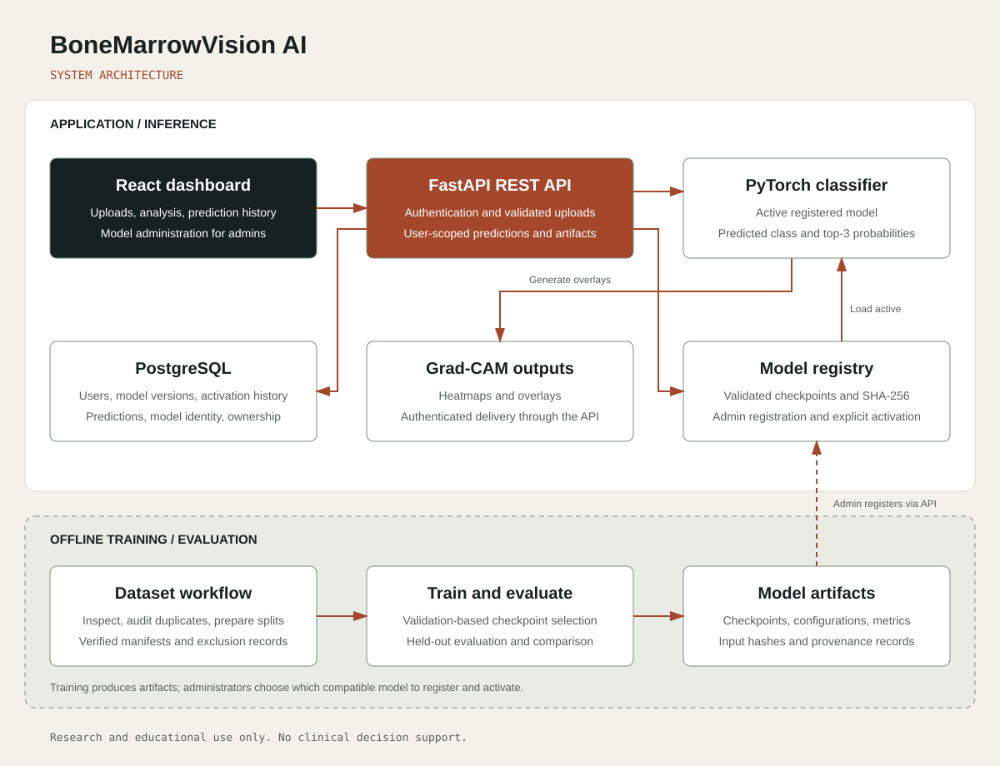

# BoneMarrowVision AI

Explainable deep-learning platform for research on multiclass bone-marrow cell image classification with PyTorch, FastAPI, PostgreSQL, React, and Grad-CAM.

> **Research and educational use only.** This software is not a medical device and must not be used for diagnosis, treatment, triage, screening, or any other clinical decision.

## Technologies and tools


## Architecture



The application consists of:

- a React web interface with authenticated research workspaces;
- a FastAPI API with Argon2 password hashing, signed JWT sessions, role-based model administration, validated uploads, and user-scoped predictions;
- process-local rate limits for authentication and inference, plus automatic retention of generated Grad-CAM and temporary inference files;
- PostgreSQL in Compose or SQLite for local development, managed with Alembic migrations;
- a PyTorch training/evaluation pipeline with deterministic controls, verified split manifests, checkpoint provenance, aggregate reports, and Grad-CAM;
- authenticated Grad-CAM delivery; uploaded and generated images are not exposed through a public static directory.

## Scientific status

The repository includes code, tests, configuration, and selected de-identified reports. Raw TCIA images, uploads, processed splits, and model checkpoints are local artifacts and are ignored by Git.

The recorded 40-epoch experiment is historical: it predates the current strict split-manifest and artifact-provenance implementation. Its aggregate metrics are retained for reference, but a new end-to-end run through the current pipeline is required before claiming complete computational reproducibility. Patient-level independence also cannot be established from the downloaded file layout because no patient, slide, case, or source mapping was available to this project.

## Requirements

- Python 3.11
- Node.js 22.23.2 or newer
- Docker with Compose, only for the containerized stack
- a PyTorch build compatible with the host GPU driver, only when CUDA training is required

## Local setup

Create and activate a virtual environment, then install the ML package, backend dependencies, and frontend dependencies:

```bash
python -m venv .venv
python -m pip install --upgrade pip
python -m pip install -e "ml[dev]"
python -m pip install -r backend/requirements-dev.txt
cd frontend
npm ci
cd ..
```

On Windows PowerShell, activate the environment with `.\.venv\Scripts\Activate.ps1`. On Linux/macOS, use `source .venv/bin/activate`. Copy `.env.example` to `.env`, then generate independent random values for `JWT_SECRET`, `ADMIN_BOOTSTRAP_TOKEN`, and—when Compose is used—`POSTGRES_PASSWORD`:

```bash
python -c "import secrets; print(secrets.token_urlsafe(48))"
```

For a stable local session, set `JWT_SECRET` even though development mode can generate an ephemeral one. Never commit `.env`.

The API limits authentication and inference requests using `AUTH_RATE_LIMIT`, `AUTH_RATE_WINDOW_SECONDS`, `PREDICTION_RATE_LIMIT`, and `PREDICTION_RATE_WINDOW_SECONDS`. In the Compose stack, `TRUST_PROXY_HEADERS=true` makes the limiter use the client address forwarded by the bundled Nginx proxy; keep it false when the API is exposed directly or behind an untrusted proxy. Generated Grad-CAM files are retained for `GRADCAM_RETENTION_DAYS` days, while stale temporary inference inputs are removed after `INFERENCE_TEMP_RETENTION_HOURS`. These limits are process-local; deployments with multiple backend replicas must enforce distributed rate limiting at the gateway or with a shared store such as Redis.

Apply the database migration and start the API:

```bash
cd backend
alembic upgrade head
uvicorn app.main:app --reload --port 8000
```

In a second terminal:

```bash
cd frontend
npm run dev
```

The web interface is at `http://localhost:5173`, and the API documentation is at `http://localhost:8000/docs`.

## First administrator and active model

Accounts created by the public registration screen are researchers. Create the first administrator once through the API, using the configured bootstrap token:

```bash
curl -X POST http://localhost:8000/api/v1/auth/register \
  -H "Content-Type: application/json" \
  -d '{"email":"admin@example.org","password":"replace-with-a-strong-password","full_name":"Research Admin","admin_bootstrap_token":"replace-with-the-configured-token"}'
```

The token cannot create another administrator after the first one exists. Keep it secret and rotate it after bootstrap. Sign in as that administrator, place a compatible checkpoint under `models/`, and register it through Swagger with:

```json
{
  "name": "EfficientNet-B0",
  "version": "40ep-full",
  "architecture": "efficientnet_b0",
  "checkpoint_path": "models/best_model_40ep_full.pt",
  "config_path": "ml/configs/efficientnet_b0.yaml",
  "metrics_json": {
    "low_confidence_threshold": 0.6
  }
}
```

Activate the returned record with `POST /api/v1/models/{model_id}/activate`. Registration is restricted to allowed project directories, validates checkpoint structure and architecture, and records its SHA-256 digest. The checkpoint must contain `model_state`, `class_names`, and `architecture`; checkpoints written by the current training script also contain configuration, history, and provenance.

## Dataset workflow

Obtain **Bone-Marrow-Cytomorphology_MLL_Helmholtz_Fraunhofer** from TCIA and extract it under `data/raw/`. The dataset is separate from this repository and has its own attribution and usage terms. Inspect before preparing any split:

```bash
python ml/scripts/inspect_dataset.py --data-dir data/raw
python ml/scripts/prepare_data.py --config ml/configs/efficientnet_b0.yaml --data-dir data/raw --output-dir data/processed
```

The preparation command intentionally fails on unreadable images or duplicate content by default. Review `reports/dataset_summary.json`, repair or redownload incomplete files, and obtain domain review for conflicting duplicate labels. `--allow-invalid-images` and `--duplicate-policy report` are explicit research exceptions, not substitutes for documenting the problem.

If valid patient, slide, or source metadata becomes available, pass `--metadata`, `--metadata-path-key`, and `--group-key` so related samples cannot cross splits. Without a valid group field, the split is image-level and must be reported as such.

After preparation creates a verified `manifest.json`:

```bash
python ml/scripts/train.py \
  --config ml/configs/efficientnet_b0.yaml \
  --data-dir data/processed \
  --checkpoint models/best_model.pt

python ml/scripts/evaluate.py \
  --checkpoint models/best_model.pt \
  --data-dir data/processed \
  --output reports/metrics/test_report.json

python ml/scripts/analyze_results.py \
  --checkpoint models/best_model.pt \
  --metrics reports/metrics/test_report.json \
  --data-dir data/processed \
  --output-dir reports/analysis

python ml/scripts/generate_gradcam.py \
  --checkpoint models/best_model.pt \
  --image path/to/deidentified-image.jpg
```

Training writes a best checkpoint and a separate final checkpoint. Evaluation and analysis record hashes for the inputs and generated artifacts. CUDA is detected automatically; mixed precision is enabled only on CUDA.

For the experimental conditional GAN augmentation pipeline and a 50-epoch classifier
run with per-epoch checkpoints and learning curves, see the
[conditional GAN experiment guide](docs/conditional-gan-experiment.md).

## Recorded experiment

The historical EfficientNet-B0 run used 171,353 valid images across 21 classes, seed 42, 224 × 224 inputs, batch size 32, weighted cross-entropy, and 40 epochs on an NVIDIA GeForce RTX 5080.

| Metric | Image-level test result |
| --- | ---: |
| Accuracy | 86.11% |
| Balanced accuracy | 72.46% |
| Macro precision | 75.57% |
| Macro recall | 72.46% |
| Macro F1 | 73.16% |
| Weighted F1 | 86.20% |

The relatively lower macro-level metrics must be interpreted in light of the dataset limitations. The model was trained across all 21 class folders, but the historical download was incomplete: some class folders had missing or unreadable images, and the available image counts were uneven across classes. Because macro metrics give each class the same weight, underrepresented categories have a strong effect on macro precision, macro recall, and macro F1, while accuracy and weighted F1 remain more influenced by the better-represented classes. These limitations help explain the gap between the macro F1 and weighted F1 results; they do not establish that missing images were the sole cause of the observed performance.

The best recorded validation macro F1 was 72.14% at epoch 30. These are research results, not clinical-performance claims. See [MODEL_CARD.md](MODEL_CARD.md), [DATASET_CARD.md](DATASET_CARD.md), and [reports/README.md](reports/README.md) for their scope and provenance limitations.

## Containerized local validation

Fill all required values in `.env`, validate the resolved Compose configuration, and start the stack:

```bash
docker compose config --quiet
docker compose up --build
```

The frontend is exposed on `http://localhost`; the backend debug port is bound only to `127.0.0.1:8000`. The backend container runs as a non-root user on a read-only filesystem, applies Alembic migrations at startup, stores uploads in a named volume, and mounts model checkpoints read-only.

The backend image installs the CPU PyTorch build. GPU dependencies belong in the training environment, not in the API container.

This is a production-like local stack, not a public production deployment. Read [SECURITY.md](SECURITY.md) before exposing any service.

## Validation

Run the complete local gate:

```bash
make check
```

Or run each platform directly:

```bash
cd ml && ruff check src scripts tests && python -m pytest tests
cd ../backend && ruff check app tests alembic && python -m pytest tests
cd ../frontend && npm run lint && npm test && npm run build
```

CI repeats the backend, ML, frontend, and Compose configuration checks.

CI also runs real browser workflows in Chromium at desktop and mobile widths using a synthetic checkpoint and image. The API image and Python CI jobs use hash-verified dependency locks for Linux x86_64 / Python 3.11 CPU environments. See [development checks](docs/development-checks.md) for locked installation, dependency updates, and local browser-test commands.

See [runtime validation](docs/runtime-validation.md) for the September 16, 2026 browser, real-inference, and Docker smoke-test results, including measured latency, memory usage, and test limitations.

## Reports and sensitive artifacts

Only deliberately reviewed, de-identified aggregate reports belong in Git. Do not commit raw data, processed split files, uploads, prediction images, patient identifiers, personal paths, credentials, tokens, database files, or checkpoints. Generated Grad-CAM images are ignored because their source can be sensitive.

## License and citation

Source code and documentation are released under the [MIT License](LICENSE). The TCIA dataset is not included and is not covered by that license. The [official TCIA collection page](https://www.cancerimagingarchive.net/collection/bone-marrow-cytomorphology_mll_helmholtz_fraunhofer/) identifies 171,375 JPG images from 945 subjects, requires the dataset citation, and lists CC BY 4.0; verify the current TCIA terms before use.

Use [CITATION.cff](CITATION.cff) to cite the software and cite the dataset separately:

> Matek, C., Krappe, S., Münzenmayer, C., Haferlach, T., & Marr, C. (2021). *An Expert-Annotated Dataset of Bone Marrow Cytology in Hematologic Malignancies* [Data set]. The Cancer Imaging Archive. https://doi.org/10.7937/TCIA.AXH3-T579

See [ETHICS_AND_LIMITATIONS.md](ETHICS_AND_LIMITATIONS.md), [CONTRIBUTING.md](CONTRIBUTING.md), and [SECURITY.md](SECURITY.md).
